



&nbsp;&nbsp;

<b>▲ PRESS START</b> opens the playable version: a pixel world that reacts to your cursor, menus you can drive with the keyboard, and chiptune bleeps.

  


  

<a href="https://github.com/srikantlose/SentinelAI">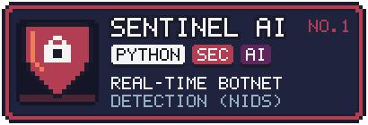</a> <a href="https://github.com/srikantlose/cheaproute-agent">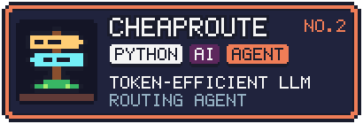</a>

<a href="https://github.com/srikantlose/fourtakes">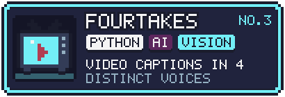</a> <a href="https://github.com/srikantlose/Penumbra">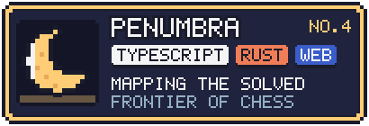</a>

<a href="https://github.com/srikantlose/ProjectSanjeevani">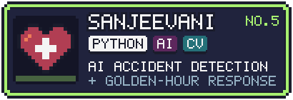</a> <a href="https://github.com/srikantlose/DevYatra">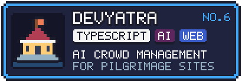</a>

 


  


 

<b>📜 QUEST LOG</b> &nbsp;·&nbsp; experience, education & side quests (click to open)

 

| | Quest | Where | Status |
|:-:|:--|:--|:-:|
| 💼 | **Software Engineer Intern**: distributed-systems reliability and payment-gateway concurrency issues | GS3 Software | ✅ Cleared |
| 🎓 | **B.E. Computer Science Engineering (Cybersecurity)**, CGPA 8.88 / 10 | MS Ramaiah Institute of Technology | ⏳ In progress |

**Side quests**

- ⚔️ **AMD Developer Hackathon: ACT II**, two entries: [CheapRoute](https://github.com/srikantlose/cheaproute-agent) (Track 1, token-efficient routing agent) and [FourTakes](https://github.com/srikantlose/fourtakes) (Track 2, video captioning agent)
- 🛕 **[DevYatra](https://github.com/srikantlose/DevYatra)**: temple and pilgrimage crowd management, submitted to GUJCOST (Government of Gujarat)
- 🚑 **[Project Sanjeevani](https://github.com/srikantlose/ProjectSanjeevani)**: final-year project on AI accident detection and golden-hour response, piloted on Bengaluru traffic footage
- 🛡️ **[CyberShield](https://github.com/srikantlose/Cybershield)**: botnet traffic classifier trained on CICIDS2017, the forerunner of SentinelAI
- ⚛️ **[Quantum error-mitigation bench](https://github.com/srikantlose/quantum-error-mitigation-bench)**: readout mitigation vs. zero-noise extrapolation on noisy circuits in Qiskit Aer
- 📚 **[GyaanGuru](https://github.com/srikantlose/gyaanguru)**: AI-generated learning roadmaps aligned to India's NSQF levels (Next.js, Supabase, Gemini)

<b>🏅 BADGE CASE</b> &nbsp;·&nbsp; full certification names

 

- **Google Cloud** · Cybersecurity Certificate
- **IBM SkillsBuild** · Getting Started with Threat Intelligence and Hunting
- **IBM SkillsBuild** · Security Operations Center in Practice
- **Anthropic** · AI Fluency: Framework & Foundations
- **Anthropic** · Claude 101

<b>💬 TALK TO SRIKAANTH</b> &nbsp;·&nbsp; pick a dialogue option

 

> **SRIKAANTH:** Oh, a visitor! What brings you to this part of the map?

&nbsp;▶ <i>"I'm hiring."</i>

 

> **SRIKAANTH:** Great timing! I've worked as a **Software Engineer Intern at GS3 Software** on distributed-systems reliability and payment-gateway concurrency, and I'm studying **CSE (Cybersecurity) at MSRIT** with an **8.88 CGPA**.
> The fastest way to reach me is [LinkedIn](https://www.linkedin.com/in/srikaanth-g-9b6553296) or [email](https://mail.google.com/mail/?view=cm&fs=1&to=srikaanth0912@gmail.com).

&nbsp;▶ <i>"Show me the security stuff."</i>

 

> **SRIKAANTH:** Start with **[SentinelAI](https://github.com/srikantlose/SentinelAI)**: real-time botnet detection with Scapy packet capture, ML flow classification and SHAP explanations for every flag. Its ancestor **[CyberShield](https://github.com/srikantlose/Cybershield)** runs a 10-step ML pipeline on CICIDS2017.

&nbsp;▶ <i>"What are you building with AI?"</i>

 

> **SRIKAANTH:** Mostly agents! **[CheapRoute](https://github.com/srikantlose/cheaproute-agent)** answers with a local Gemma model and only escalates to the cloud when it's unsure. **[FourTakes](https://github.com/srikantlose/fourtakes)** captions videos in four different voices. **[Sanjeevani](https://github.com/srikantlose/ProjectSanjeevani)** spots road accidents in traffic-camera footage within seconds.

&nbsp;▶ <i>"Got any cheat codes?"</i>

 

> **SRIKAANTH:** Psst... open the [interactive version](https://srikantlose.github.io/srikantlose/) and enter <kbd>↑</kbd> <kbd>↑</kbd> <kbd>↓</kbd> <kbd>↓</kbd> <kbd>←</kbd> <kbd>→</kbd> <kbd>←</kbd> <kbd>→</kbd> <kbd>B</kbd> <kbd>A</kbd>. You didn't hear it from me.

 

 

  

<picture>
  <source media="(prefers-color-scheme: dark)" srcset="https://raw.githubusercontent.com/srikantlose/srikantlose/output/snake-dark.svg">
  <source media="(prefers-color-scheme: light)" srcset="https://raw.githubusercontent.com/srikantlose/srikantlose/output/snake-light.svg">
  
</picture>

  


